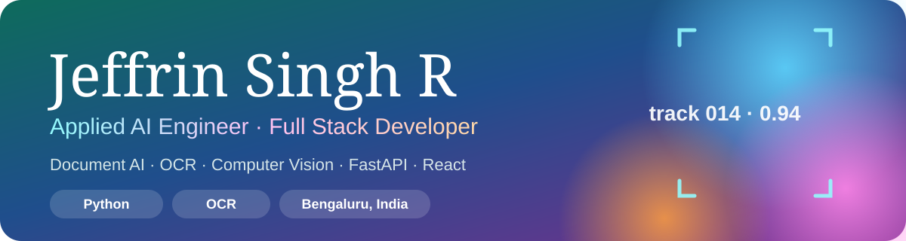

<div align="center">



<br />

[](https://jeffrin-singh-r-portfolio.vercel.app/)
[](mailto:jeffrinsingh854@gmail.com)
[](https://www.linkedin.com/in/jeffrin-singh-r-6721792a3/)
[](https://github.com/Jeffrin-Singh)

</div>

---

## ✨ About

I build **production AI systems and web platforms**. My current focus is **Python Document AI and OCR**: invoice data extraction, GSTIN and PAN identification, and OCR benchmarking. Earlier I built real-time computer vision pipelines, including number-plate tracking and face recognition.

## 🚀 Highlights

| | Feature | What it does |
|---|---|---|
| 🪟 | **Glass UI** | Frosted surfaces, a floating navigation pill and cursor-follow light on cards |
| 🌀 | **WebGL intro** | A liquid-glass background with a shine-animated loader and progress bar, for 1.5 seconds |
| ✍️ | **Word reveals** | Headlines animate word by word as you scroll |
| 🔁 | **Scroll motion** | Sections animate in every time you scroll back to them |
| 🛰️ | **Hero visual** | Rotating rings and a soft colour blob, with parallax on scroll |
| 📱 | **Responsive** | Works on phones, tablets and desktops, with a mobile menu |
| ♿ | **Accessible** | Keyboard focus styles, semantic landmarks and reduced-motion support |
| ⚡ | **Zero build** | One `index.html` file with no build step |

## 🧰 Tech Stack

<p align="left">
  
  
  
  
  
  
</p>

<p align="left">
  
  
  
  
  
  
  
  
  
</p>

## 🗺️ Sections

| Section | What it shows |
|---|---|
| 🏠 **Hero** | Role, introduction, key metrics and quick actions |
| 👤 **About** | Summary and core tools |
| 💼 **Experience** | Exalca, Invendoi AI Solutions and Silvia Softwares, plus earlier academic work |
| 🗂️ **Projects** | Featured case study, a project details dialog and the other projects |
| 🛠️ **Skills** | Frontend, backend, databases, AI/ML and DevOps |
| 📬 **Contact** | Email, GitHub and LinkedIn |

## ▶️ Run Locally

No install or build is needed.

```bash
# Option 1: double-click index.html, or open it from your browser

# Option 2: local server (recommended)
npx serve .
# or
python -m http.server 8000
```

## 📁 Project Structure

```
.
├── index.html                  # The whole site: markup, styles and scripts
├── Jeffrin_Singh_R_Resume.pdf  # Downloadable resume
├── assets/
│   └── banner.svg              # README banner
├── agent-skills-main/          # Agent skill files (not used by the site)
├── .gitignore
└── README.md
```

## 🎨 Customising

All content lives in `index.html`:

- **Hero:** the `<section id="hero">` block.
- **Experience:** `<section id="experience">`. Each role is a `.job` item.
- **Projects:** `<section id="projects">`. The featured card is `.featured`, and the others are `.project-card`. The details dialog is `#projectModal`.
- **Skills:** the `.skill-card` items in `<section id="skills">`.
- **Colours and type:** the `:root` variables at the top of the `<style>` block.
- **Loader timing:** the `1500` value in the intro script, in milliseconds.
- **Resume:** replace `Jeffrin_Singh_R_Resume.pdf` with a new file of the same name.

## 🌐 Deploy

The site is static, so any static host works. On Vercel:

1. Push the repository to GitHub.
2. Import it in Vercel.
3. Keep the framework preset as **Other**, then deploy. No build command is needed.

## 📬 Contact

<div align="left">

[](mailto:jeffrinsingh854@gmail.com)
[](https://github.com/Jeffrin-Singh)
[](https://www.linkedin.com/in/jeffrin-singh-r-6721792a3/)

</div>

---

<div align="center">

Made with ❤️ and a lot of ☕ · © 2026 Jeffrin Singh R · All rights reserved

</div>
